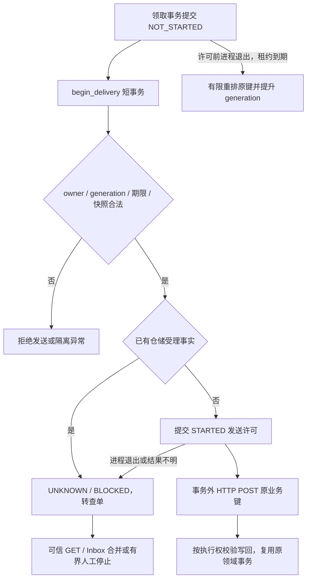

# C 阶段可靠性补强：发送许可与故障边界

2026-10-29。本批继续 C1/C2 的单条换货出库链，不增加角色、业务、Agent 工具或外部平台。历史 C1/C2 契约与证据保持冻结；当前发送协议以本文的增量约束为准。

## 1. 新的持久事实

`0011_dispatch_intent` 为 `outbox_attempts` 增加：

| 字段 | 含义 |
|---|---|
| `send_state=NOT_STARTED` | 新协议领取已提交，尚未授予本次 HTTP 发送许可 |
| `send_state=STARTED` | 发送许可已提交；可能已经发送，不证明 socket 实际打开 |
| `send_state=LEGACY_UNKNOWN` | 旧协议或历史尝试，无法证明是否发送 |
| `send_started_at` | 许可提交事务中的时间；仅 STARTED 非空 |

迁移和数据库默认均为 `LEGACY_UNKNOWN`，新协议 claim 显式写 `NOT_STARTED`。不能根据旧行的空时间、HTTP 错误或仓储 404 推导“未发送”。CHECK 约束校验状态枚举与时间配对。迁移不重写旧业务事实、尝试结果、回执或库存；禁止破坏性降级。

## 2. Consumer 协议

`begin_delivery(claim)` 必须在许可事务成功提交后才返回。生产 Worker 随后调用有总时间预算的 HTTP 客户端；网络期间不持数据库锁。许可复核唯一 Outbox、请求、领域快照、库存不变量、owner、generation 和租约，flush 后再次核对期限。

同一许可只发放一次。重复调用返回 `DELIVERY_ALREADY_STARTED`，失权返回 `OUTBOX_LEASE_LOST`，两者均不调用 HTTP。新 NOT_STARTED 不能直接 `finish` 伪造外部结果；返回 `DELIVERY_NOT_STARTED`。旧 LEGACY_UNKNOWN 在仍持有合法执行权时可按原协议完成结果写回，迁移不会凭空授予第二次发送许可。

如果 seq1 ACCEPTED 回调已经绑定外部单或接受序号，即使本次尝试仍为 NOT_STARTED，也必须转 UNKNOWN/BLOCKED，并把该尝试关闭为 UNKNOWN/PROVIDER_ALREADY_ACCEPTED。已有仓储事实优先于局部“本次未发”的信息，交原可信查单或后续回调完成，不能再授予 POST。

## 3. 许可前安全重排

过期 CLAIMED 只有同时满足以下条件才可重排：

- 当前快照仍是原批准出库申请，库存仍满足原领域约束。
- 当前尝试明确为新协议 NOT_STARTED。
- 请求没有 `provider_external_id`，接受序号 `last_sequence=0`。

过期尝试记录 `RETRYABLE/HTTP_NOT_STARTED`，保留 NOT_STARTED 和空许可时间。Outbox 提升 generation 使旧 claim 失权，清除租约，保持同一 key、参数、摘要、申请版本及库存预留。当前轮未耗尽则回 PENDING；耗尽则 MANUAL_REVIEW/DEAD，不能无界重新领取。原客服 redrive 仍要求权限、CAS、幂等命令、历史明确未受理证据及预算，不增加新接口。

快照仍合法时，STARTED、LEGACY_UNKNOWN 或任何已有受理事实的过期尝试继续 UNKNOWN/BLOCKED；快照异常则隔离为 MANUAL_REVIEW/DEAD。GET 404 不是未受理证明。查询预算耗尽时保留 RESERVED 和 v5，拒绝 redrive；不能伪造完成或释放未知出库的库存。

## 4. 两个回调修正

发送器只接受 200/202 且包含有效 `inbox_id`、允许的 Inbox `status`、与所发送事件完全相同的 `event_id` 的回执。遗漏或错误 event_id 返回 UNKNOWN；ACK 仅证明持久接收事件，业务是否完成仍由 Inbox 和领域状态决定。

独立仓储的 `claim_event`、`finish_event` 在取得 SQLite `BEGIN IMMEDIATE` 写锁后采样生产时钟。finish 的到期判断计入锁等待，不能用锁前时间确认一个实际已过期的领取；claim 的新租约从取得写锁后起算，不能返回已缩水的租约。显式传入 `now` 的测试逻辑时钟继续保持固定值，不借此替换真实进程租约验证。

## 5. 验收与真实故障定义

工程回归包括许可互斥、旧 owner、锁等待跨期限、flush 期间过期回滚、迁移历史行、有限重排、已受理回调抢先、回调 ACK 绑定、SQLite 真实锁等待及原 C2 恢复测试。

`scripts/backend_c_reliability_smoke.py` 只在 55434/aftercare_test、显式关闭真实模型时运行，使用独立本机进程、唯一测试员工及合成库存，不清库。五项受控验证：

| 场景 | 必须留存的触发证据 |
|---|---|
| 仓储成功，响应真实丢失 | 代理完整收到上游 200，但向 Consumer 发送 0 字节并关闭连接；本地 UNKNOWN 后 GET 原键恢复 |
| 领取后、许可前 SIGKILL | 已提交 CLAIMED/NOT_STARTED、provider 0 行；自然租约到期后新 Worker 安全完成原键 |
| 旧发送者恢复 | 未许可旧 claim 自然过期，新 Worker 完成后放行旧 begin_delivery；旧者失权且 HTTP 次数不增加 |
| 许可后、socket 前 SIGKILL | STARTED 已提交但代理未收到 POST；三次真实 GET 404 后人工停止，拒绝重投并保留库存 |
| 回调已被真实 ACK，发送器 finish 前 SIGKILL | Inbox 和业务已提交，provider 事件仍 CLAIMED；自然租约到期、真实重启后重发同 event_id，Inbox/审计/库存不重复 |

另以同一条已批准业务请求进行 10 次真实协议重放，分布在 provider 重启前后，核对唯一出库事实、外部单号和两条稳定事件；异参复用同键必须 409。这是有意的幂等协议探针，不是给 UNKNOWN Worker 开放自动 POST。

## 6. 明确限制

发送许可事务提交到 socket 发送之间仍存在不可消除的不确定窗口。本批仅让“可证明尚未授予发送许可”的尝试安全恢复；不声称任意崩溃都会自动成功。仓储记录唯一副作用依赖其持久幂等键与绑定校验，产品侧接受重复投递并保护库存最终一致，不能据此声称网络 exactly-once。

所有验证均为本地单商户模拟仓储、受控故障位置；不是生产可用性、任意调度组合或性能吞吐结论。D 的性能基线、Trace、CI 和部署工作仍另行按顺序推进。
