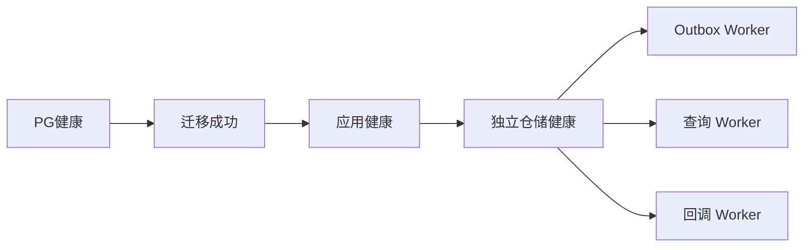

# D4 离线 CI 与容器交付契约

2026-10-30。承接 D3，按原路线完成 CI/Docker 工程化。业务状态机、可信确认、权限、库存、Outbox/Inbox/UNKNOWN、发送许可与仓储协议不变；迁移版本仍0011。本批不做新性能收益声明。

## CI 与事实边界

新增GitHub Actions工作流：固定Python/Node版本、Actions完整commit SHA和PG17/pgvector多架构OCI index；依赖按requirements.lock的hash安装，再安装当前项目。依赖与镜像下载属于在线准备，测试显式关闭真实模型/权重，并使用pytest网络限制。

先校验DATABASE_URL与AFTERCARE_TEST_DATABASE_URL都精确为127.0.0.1:55434/aftercare_test，再运行原迁移CLI和只读PG17/schema/ready/空model_calls门禁。连接失败直接失败，不能依赖原fixture的skip机制使CI变绿。完整JUnit必须有既定B/C/D关键模块及D3基线数量，只接受原4个可选tau2 collection skip；失败、空报告、数据库缺失导致的skip、单元测试子集均拒绝。

Ruff、格式、pip check、完整离线pytest和独立Node队列测试保留原始输出；最后构建canonical镜像并检查无网络容器内锁版本。always上传本次日志，artifact名含run_id/run_attempt。没有推送或触发GitHub云端执行时，只能称配置及本地等价检查完成，不能称云CI已绿或分支保护已启用。

## 镜像构建

Dockerfile默认使用原固定Python基础镜像并执行hash安装。已缓存本地运行时可显式选择BASE_IMAGE及REUSE_LOCKED_RUNTIME=true：先验证所有本平台锁版本无缺失/冲突，再卸载锁外分发，重装当前项目并严验锁集合及pip check。不通过卸载来掩盖版本冲突，不改原基础镜像或覆盖旧tag。

复用路径验证的是分发metadata版本，不是重新验证已安装wheel的原始hash。默认干净下载构建与Linux/AMD64云runner若未实际运行必须列为未执行。镜像构建层先删除固定旧源码/资产目录再COPY当前树，防止合并残留；实际镜像文件集合/指纹另验。运行用户UID10001，预建可写仓储目录；runtime、密钥、测试和历史证据不进入build context。

## Compose 拓扑

独立compose.backend.yaml不替换旧compose.yaml。项目名、端口和三个命名卷隔离；本轮验收使用aftercare-d4-test，数据库55436、应用8138，数据库名称仍aftercare_test。测试覆盖新专用栈，不连接旧demo/真实账本。

app持有网络namespace，warehouse/Outbox/query/callback及可选scripted Agent容器共享它。仓储继续只监听127.0.0.1:8152，回调走127.0.0.1:8000；不放宽原literal-loopback检查。PostgreSQL仍通过共享Unix socket访问，PG与仓储SQLite使用不同卷。仓储卷挂在CLI允许的/app/runtime/mock-warehouse，同UID持有DB/WAL/SHM目录写权限。

应用仅回环发布HTTP，普通配置不启用客户demo登录；验收overlay只启用该登录。宿主DNAT端口无法访问容器内只绑定loopback的仓储，因此验收工具经固定新仓储容器的docker exec，在其namespace内发真实HTTP。凭据/正文经stdin，进程参数和日志不含token；禁止代理/重定向和任意目的地址。普通业务Worker继续用原HTTP client。

投递/查询Worker使用Bearer、仓储验证Bearer，回调sender使用HMAC、应用验证HMAC；两种密钥必填且不同，由原Settings校验。仓储只持Bearer并持久生成回调事件，独立sender负责发送，避免内联发送混淆验收步骤。默认不开放故障注入接口。

应用、仓储和Worker采用非root、只读rootfs、/tmp tmpfs、丢弃capabilities、no-new-privileges、init、CPU/内存/PID限制与日志轮转；仅状态和socket卷例外。数据库使用PG镜像的标准入口和独立卷，不启用只读rootfs。Worker原领取/发送/完成逻辑、轮询间隔与有界HTTP不变，D3日志显式开启。资源上限只是配置限制，不是性能或可用性保证。

## 启动、迁移与持久化验收

原db migrate作为one-shot成功后才启动app，健康检查必须连真实数据库且schema为0011；进程启动不等于ready。新增可信外部Connection支持，只用于调用方持有的私有schema事务；原普通CLI仍自建/释放连接。调用方可指定version_table_schema，避免读取public版本或关闭调用方事务。

有业务迁移使用新测试库的私有schema：原Alembic到0006→结构性历史fixture→原迁移到0010→旧出库attempt→原迁移到0011。比较所有旧列投影，验证旧receipt、库存和未知用量保留，旧attempt为LEGACY_UNKNOWN，不伪称未发送。该fixture不是新真实模型/HTTP调用；public另有真实三角色HTTP业务链。

真实业务验收先停履约Worker，批准一个请求并保存v5/PENDING、RESERVED与原回执；移除和重建本次容器/网络但保留卷，仍读到同一请求。启动原Outbox/query后，核对v6、CONSUMED、库存只扣一次、同provider事实。重启仓储及整组服务后，同键POST/GET仍返回原事实。最后启动回调sender，验证provider ACK送达和Inbox对已完成事实的STALE持久接收，不再次推进业务或消费。

app是共享网络持有者：重建app须协调重建全部共享namespace的服务。不能把任意单独recreate app称为透明滚动升级。验收脚本只控制固定provider exec，不控制容器生命周期、不清库、不删卷；root显式操控本次项目并保存状态证据。

## 收尾与停止点

原A/B/C/D1/D2/D3证据不覆盖；旧测试库在完整pytest前先备份，现有测试fixture的清理不涉及旧demo。新栈保留业务事实、SQLite一致backup及迁移fixture，验收结束停止本轮容器释放运行内存，不删除命名卷。

首次失败、红绿测试和工具超时单列，不覆盖或改成成功；重跑使用新证据目录。D4完成完整离线回归、本地容器验收、报告和交接后结束本阶段。不自动增加业务、外部平台、云模型、公共部署或GitHub推送。

参考：[Compose服务](https://docs.docker.com/reference/compose-file/services/)、[健康与启动依赖](https://docs.docker.com/compose/how-tos/startup-order/)、[GitHub PostgreSQL service](https://docs.github.com/en/actions/tutorials/use-containerized-services/create-postgresql-service-containers)。本批实际结果见D4交接与验证清单。
