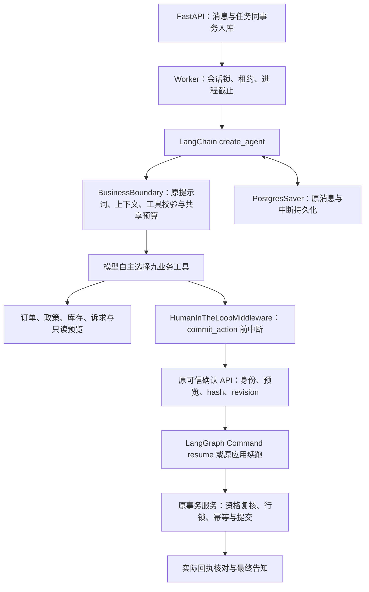

# LangChain 轻量 Agent：基线迁移架构

2026-10-26。基线 `5b435ead0c3b9f998c89d9d31f510ec29ad77884`；独立分支 `refactor/langchain-lite`。只做框架迁移，不迁入后续实验优化。

## 执行链路

`create_agent` 负责模型→工具→模型循环，底层仍是 LangGraph。模型可以先查询目录再查询订单，也可以反过来；迁移测试分别给出不同工具响应计划，在同一用户输入下验证两种路径实际执行。默认路径未调用 `fixed-workflow`。脚本模型的路径选择验证不代表真实模型决策水平已经提高。

## 创建入口的变化

`src/aftercare/agent/runtime.py` 删除 Deep Agents 的导入、HarnessProfile 注册、通用子 Agent 配置及排除工具配置。现在只创建：

1. 原 `BusinessBoundary`；
2. LangChain 原生 `HumanInTheLoopMiddleware`，只拦截 `commit_action`，明确 `interrupt_mode="batched"`；
3. 原九个 StructuredTool 和 PostgresSaver。

未增加摘要、文件系统、Todo、Skills、task 或子 Agent。业务 Prompt 和工具契约完全沿用基线。原 `src/aftercare/harness/` 中框架无关的 ContextPolicy/评测预算资产保留；目录名字不是 Deep Agents 依赖。

## HITL 协议与业务批准

原中断消费者读取 `state.tasks[*].interrupts[*].value.action_requests`，恢复时使用 `Command(resume={"decisions": [...]})`。LangChain 原生 batched 模式保留这一结构；迁移测试验证 action_requests、review_configs、允许的 approve/reject，以及重建图后的实际提交。

框架 approve 仍不能代替业务 API 批准。原 `continue_confirmation` 原样保留：校验精确绑定事件→匹配中断后 resume，或图已结束时调用同一提交服务；旧批准、错预览、重复恢复及未知提交继续受业务规则约束。没有用工具返回成功或 graph END 伪造完成。

## 功能差异

| 项目 | 5b435ea Deep Agents 基线 | 当前轻量实现 |
|---|---|---|
| Agent 创建 | create_deep_agent + 禁用部分通用能力的 HarnessProfile | create_agent + 两个明确 Middleware |
| 模型与业务工具 | 原脚本/受控适配、九工具 | 同一实现与契约 |
| LangGraph / PostgresSaver | 使用 | 保留相同锁定版本 |
| HITL | Deep Agents 添加原生 HITL | 直接添加同一 LangChain 原生 batched HITL |
| 消息、业务 Prompt、上下文装配 | 原 BusinessBoundary | 文件内容原样保留 |
| 资格/数量证据/确认/事务/回执 | 业务服务裁决 | 原样保留 |
| 图状态 | 可能带 Deep Agents 的 files/todos 等通用字段 | 业务测试不依赖这些字段；默认图不生成它们 |
| D1/CE/S1/S2/S3 | 尚未存在于此基线 | 不迁入 |
| 工程依赖 | 105 个锁定包 | 89 个，保留包版本/哈希不变 |
| Docker 资源命名与默认端口 | 原项目名、55432/8000 | 独立项目/镜像名、55435/8130；测试55434 |

不迁移旧 Deep Agents checkpoint 到新数据库。用户历史运行与账本留在原环境，迁移验收使用新会话、新 checkpoint 和独立数据库，因此没有隐含历史状态格式兼容承诺。

## 依赖处理

显式依赖 `langchain==1.4.6`，沿用基线安装的 langchain-core 1.6.12、LangGraph 1.2.16、Postgres checkpoint 3.2.0。移除 Deep Agents 及仅经其引入的 Anthropic/Google 提供商、wcmatch 等依赖；原百炼 HTTP 适配不变。

没有联网重新解析或升级依赖。`scripts/migration/prune_lock.py` 以基线锁和同版本已安装 metadata，分别遍历 Darwin/Linux 根依赖，保留所需包原版本和所有原制品哈希。缺 metadata、版本不符或发现原锁外依赖时拒绝；它不是通用新依赖解析器。`pip check` 在已移除这16个包的独立环境通过。

当前验证覆盖 macOS/Python3.13 本机环境。Dockerfile 与锁继续保留 Linux 所需原有条目，但本轮没有重新联网构建镜像或在 Linux 上验收，不能声称容器新镜像已发布。
